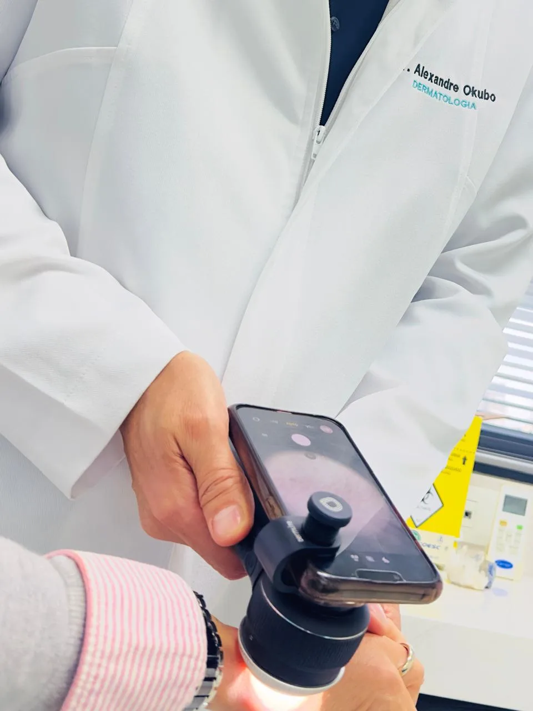

"Doutor, essa feridinha no nariz sangra, fecha e abre de novo há meses. Achei que era espinha." Essa é uma das falas mais comuns que ouço antes de um diagnóstico de câncer de pele. Em geral não dói, e por isso costuma ficar para depois.

## Dezembro Laranja: por que falar de câncer de pele agora

Dezembro Laranja é a campanha de prevenção do câncer de pele no Brasil. Ela acontece no início do verão, quando a exposição ao sol aumenta. Aproveite para olhar a própria pele e, se o exame com o dermatologista estiver atrasado, marque.

## O que é o câncer de pele

O câncer de pele é o tipo de câncer mais comum no Brasil. Para cada ano entre 2026 e 2028, o Instituto Nacional de Câncer (INCA) estima 263.280 casos novos de câncer de pele não melanoma (o basocelular e o espinocelular) e 9.360 de melanoma. Em 2023, o câncer de pele não melanoma causou 3.541 mortes, e o melanoma, 2.047.

É o crescimento descontrolado de células da pele, causado sobretudo pelo dano que a radiação ultravioleta do sol acumula ao longo da vida. Existem três tipos principais:

- **Carcinoma basocelular:** o mais comum. Cresce devagar e quase nunca se espalha para outros órgãos, mas pode destruir a pele e as estruturas em volta se não for tratado.
- **Carcinoma espinocelular:** o segundo mais comum. Também cresce na pele exposta ao sol e, em alguns casos, pode se espalhar.
- **Melanoma:** menos comum e mais grave, porque tem mais chance de se espalhar. Descoberto cedo, quando ainda é fino, tem bom prognóstico.

## Como identificar o câncer de pele

### Carcinoma basocelular

Aparece como uma bolinha rosada ou perolada, brilhante, às vezes com vasinhos na superfície, ou como uma ferida que sangra, forma casca e não cicatriza. É mais comum no rosto, nas orelhas, no pescoço e no colo.

### Carcinoma espinocelular

Aparece como uma lesão áspera, com casca grossa, que cresce em semanas ou meses e pode doer ao toque. É comum no rosto, nos lábios, nas orelhas, no dorso das mãos e no couro cabeludo de quem tem calvície.

### Melanoma e a regra ABCDE

O melanoma costuma surgir como uma pinta nova ou como uma pinta antiga que muda. A regra ABCDE ajuda a reconhecer os sinais de alerta:

- **A, assimetria:** uma metade da pinta é diferente da outra.
- **B, bordas:** irregulares, borradas ou recortadas.
- **C, cor:** mais de uma cor na mesma pinta (marrom, preto, vermelho, branco ou azulado).
- **D, diâmetro:** maior que 6 mm, o tamanho de uma borracha de lápis.
- **E, evolução:** a pinta muda de tamanho, forma ou cor, coça ou sangra.

Há também o sinal do "patinho feio": a pinta diferente de todas as outras da mesma pessoa deve ser examinada, mesmo que não preencha o ABCDE.

### Ceratose actínica: o aviso antes do câncer

São manchas ásperas, como uma lixa, avermelhadas ou cor de pele, em áreas expostas ao sol. A ceratose actínica não é câncer, mas é um sinal de dano solar e pode, em parte dos casos, evoluir para o carcinoma espinocelular. Por isso trato as lesões, principalmente com crioterapia (congelamento com nitrogênio líquido) e com o creme de imiquimode.

## Quem tem mais risco

- **Pele clara**, que queima com facilidade e quase não bronzeia.
- **Muito sol ao longo da vida**, principalmente queimaduras na infância e na adolescência.
- **Bronzeamento artificial.**
- **Muitas pintas** ou pintas atípicas.
- **Histórico pessoal ou familiar** de câncer de pele.
- **Idade mais avançada.**
- **Imunidade baixa**, como em quem tomou remédios depois de um transplante.

## Como é feito o diagnóstico

Na consulta, examino a pele e uso a dermatoscopia, uma lente de aumento com luz especial encostada na pele, que mostra estruturas invisíveis a olho nu. Ela ajuda a separar uma lesão benigna de uma suspeita.

Quando a lesão é suspeita, faço a biópsia no consultório: retiro uma amostra, ou a lesão inteira, com anestesia local, e envio para análise. O resultado da biópsia confirma o diagnóstico.

Explico como é o exame na página de [avaliação de pintas com dermatoscopia](/avaliacao-de-pintas/).

## Câncer de pele tem cura?

Na maioria dos casos descobertos cedo, o tratamento resolve a lesão e o prognóstico é bom. O tratamento principal dos carcinomas basocelular e espinocelular é a retirada cirúrgica completa, segundo a diretriz europeia de 2023. Faço essa cirurgia nas duas clínicas, com anestesia local, e envio a peça para exame, para confirmar que a lesão saiu inteira.

No melanoma, faço a biópsia e, quando o diagnóstico é confirmado, encaminho para o tratamento especializado. O que mais pesa no prognóstico é a espessura do melanoma: os finos, com menos de 0,8 mm, em geral não precisam de outro tratamento depois da retirada com margem.

## Como prevenir o câncer de pele

O protetor solar usado todos os dias ajuda. Num ensaio clínico randomizado na Austrália, com 1.621 adultos, quem passou protetor diariamente por cerca de quatro anos teve menos melanomas nos dez anos seguintes: 11 casos, contra 22 no grupo que usava só quando queria. A diferença ficou no limite da significância estatística, mas foi maior nos melanomas invasivos. A fase inicial do mesmo ensaio já tinha mostrado menos carcinoma espinocelular com o uso regular.

Outras medidas:

- **Sombra e horário:** evite o sol forte do meio do dia.
- **Roupa, chapéu e óculos:** protegem mais do que o protetor sozinho.
- **Bronzeamento artificial:** não faça.
- **Crianças:** a proteção na infância conta para o resto da vida.
- **Autoexame:** olhe a pele uma vez por mês, com espelho, incluindo couro cabeludo, sola dos pés e entre os dedos.

## Nem toda pinta escura é câncer

Muitas lesões que assustam são benignas. A mais comum é a ceratose seborreica, a "verruga da idade", marrom e com aspecto de colada na pele. Explico como diferenciar no artigo sobre [ceratose seborreica e quando ela precisa de exame](/blog/ceratose-seborreica/). Pintas comuns, sardas e manchas de sol também costumam ser benignas. A dermatoscopia ajuda a separar uma coisa da outra, e a biópsia resolve a dúvida quando ela continua.

## Quando procurar um dermatologista

Marque uma consulta se você tem:

- Uma pinta nova na vida adulta, ou uma pinta que mudou.
- Uma ferida que não cicatriza em algumas semanas.
- Uma lesão que sangra, coça ou cresce.
- Pele clara, muitas pintas ou câncer de pele na família.

Para quem tem pele clara e muitas pintas, recomendo o exame da pele uma vez por ano. Atendo nas duas clínicas, com agendamento pela Doctoralia.

Saiba mais sobre a [dermatologia clínica e a avaliação de lesões de pele](/dermatologia-clinica/).
