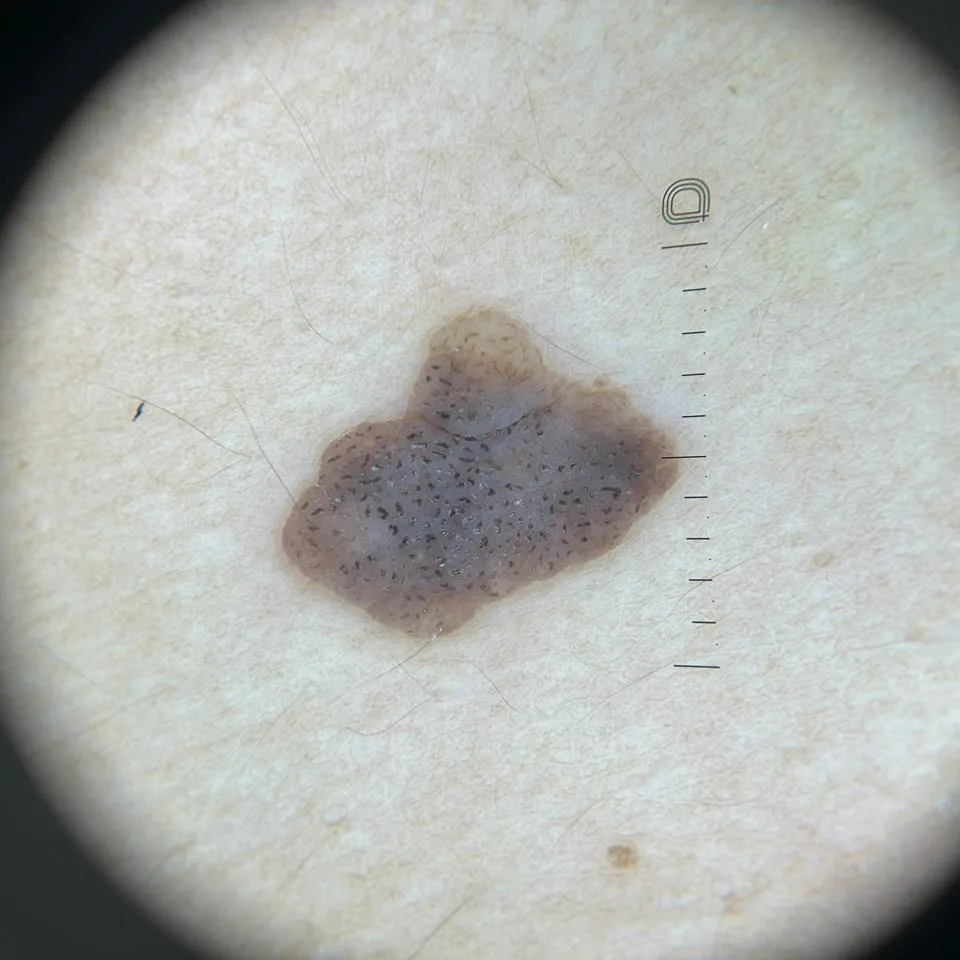

"Doutor, estão aparecendo umas manchas escuras e ásperas nas costas. Parecem verrugas. Minha pele está envelhecendo ou é algo pior?" Na maioria das vezes, são ceratoses seborreicas.

## O que é a ceratose seborreica

A ceratose seborreica é a lesão benigna mais comum da pele. Ela é formada por células da camada mais superficial da pele (a epiderme), que se multiplicam e se empilham. Não é verruga, porque não é causada por vírus, e não passa de uma pessoa para outra.

### Como reconhecer

- **Cor:** do bege ao marrom-escuro, às vezes quase preta.
- **Superfície:** áspera, granulosa ou com aspecto de cera.
- **Aspecto de "colada" na pele,** como se desse para tirar com a unha.
- **Locais:** sobretudo o rosto e a parte de cima do tronco. Ela pode aparecer em qualquer lugar, menos nas palmas das mãos e nas plantas dos pés.

Ela é mais comum em adultos mais velhos, e o número de lesões aumenta com a idade. Em peles negras e pardas, é comum uma forma com várias bolinhas escuras pequenas no rosto, chamada dermatose papulosa nigra.

## Por que aparece

A idade é o fator mais forte. A predisposição genética também pesa: é comum ver várias pessoas da mesma família com muitas lesões. O sol parece contribuir, porque a ceratose está ligada ao envelhecimento da pele causado pela radiação ultravioleta.

Ela não está relacionada a falta de higiene nem à oleosidade da pele, apesar do nome "seborreica".

## A ceratose seborreica vira câncer?

Não. As alterações genéticas encontradas nas ceratoses não dão a elas potencial de virar câncer.

O risco é de confusão: algumas ceratoses são muito parecidas com um melanoma, e alguns melanomas são parecidos com ceratoses. Uma revisão italiana sobre esses casos aponta que eles podem ser difíceis de separar a olho nu, mesmo para dermatologistas experientes.

### O que a dermatoscopia mostra

A dermatoscopia é um exame feito na consulta, com uma lente de aumento e luz especial encostada na pele. Ela mostra estruturas que não aparecem a olho nu. Na ceratose seborreica, por exemplo, aparecem pequenos cistos brancos e aberturas parecidas com cravos, que ajudam a confirmar o diagnóstico.

*Ceratose seborreica vista no dermatoscópio, com a régua do aparelho ao lado. Os pontos escuros são as aberturas parecidas com cravos. Foto de paciente, publicada com autorização.*

Faço a dermatoscopia nas lesões escuras durante a consulta. Quando ela não deixa o diagnóstico claro, faço a biópsia, e o exame ao microscópio confirma o que é. Explico como funciona a [avaliação de pintas](/avaliacao-de-pintas/) no consultório.

### Quando muitas aparecem de repente

Muito raramente, o surgimento de muitas ceratoses em poucas semanas ou meses está associado a um câncer interno. Esse quadro é chamado de sinal de Leser-Trélat. A ceratose que aparece devagar ao longo dos anos não tem esse significado. Mas, se várias surgirem de uma vez, conte na consulta.

## Precisa tirar?

A ceratose seborreica não traz risco à saúde, então a retirada é uma escolha do paciente. Os motivos mais comuns são:

- **Incômodo estético,** sobretudo no rosto.
- **Atrito** com a roupa, o sutiã ou o cinto, que irrita a lesão.
- **Coceira** ou sangramento depois de coçar.

### Como é a retirada

A retirada é feita no consultório, com anestesia local quando o método pede. Uso três métodos, nas duas clínicas:

- **Criocirurgia:** congelamento com nitrogênio líquido. A lesão forma uma casca e cai.
- **Eletrocoagulação:** uma corrente elétrica fina remove a lesão.
- **Plasma:** a energia do plasma remove a lesão camada por camada.

Existem também a curetagem, a raspagem (shaving) e o laser. A escolha depende do tamanho, do local e do número de lesões.

Em um ensaio randomizado iraniano com 35 homens, um lado do corpo foi tratado com plasma e o outro, com criocirurgia. Depois de 6 semanas e duas sessões, 57% das lesões avaliadas no lado do plasma tinham sumido, contra 21% no lado da criocirurgia. O estudo foi pequeno e só incluiu homens.

Os tratamentos com cremes e soluções ainda têm efeito limitado. Uma solução de peróxido de hidrogênio a 40% foi testada em ensaios clínicos e pode vir a ser uma alternativa, sobretudo no rosto.

Os efeitos colaterais possíveis de todos os métodos são mancha clara ou escura no local, cicatriz e volta da lesão.

Congelar ou vaporizar a lesão não deixa material para o microscópio. Por isso, quando há dúvida no diagnóstico, retiro a lesão ou faço uma biópsia e envio para exame antes de tratar.

## Nem toda mancha escura e áspera é ceratose seborreica

- **Melanoma:** a lesão que muda de tamanho, de forma ou de cor, que tem várias cores ou bordas irregulares, deve ser examinada. Explico os sinais de alerta na [avaliação de pintas](/avaliacao-de-pintas/).
- **Ceratose actínica:** manchas ásperas e avermelhadas em áreas de sol, como o rosto, as orelhas e o dorso das mãos. Ela pode evoluir para câncer de pele e tem tratamento diferente.
- **Carcinoma basocelular pigmentado:** pode ser escuro e brilhante, e às vezes sangra com facilidade.
- **Verruga viral:** causada por vírus, mais comum nas mãos e nos pés.
- **Lentigo solar:** a "mancha de sol", plana e lisa, sem a superfície áspera.

## Quando procurar um dermatologista

Procure avaliação na primeira vez que essas lesões aparecerem, para confirmar o diagnóstico com dermatoscopia. Depois, procure de novo se uma delas mudar de cor, crescer rápido, sangrar sem ter sido coçada ou parecer diferente das outras. Procure também se muitas surgirem em pouco tempo.

Veja como é feita a retirada de ceratoses e outras lesões benignas na [cirurgia dermatológica](/cirurgia-dermatologica/).
