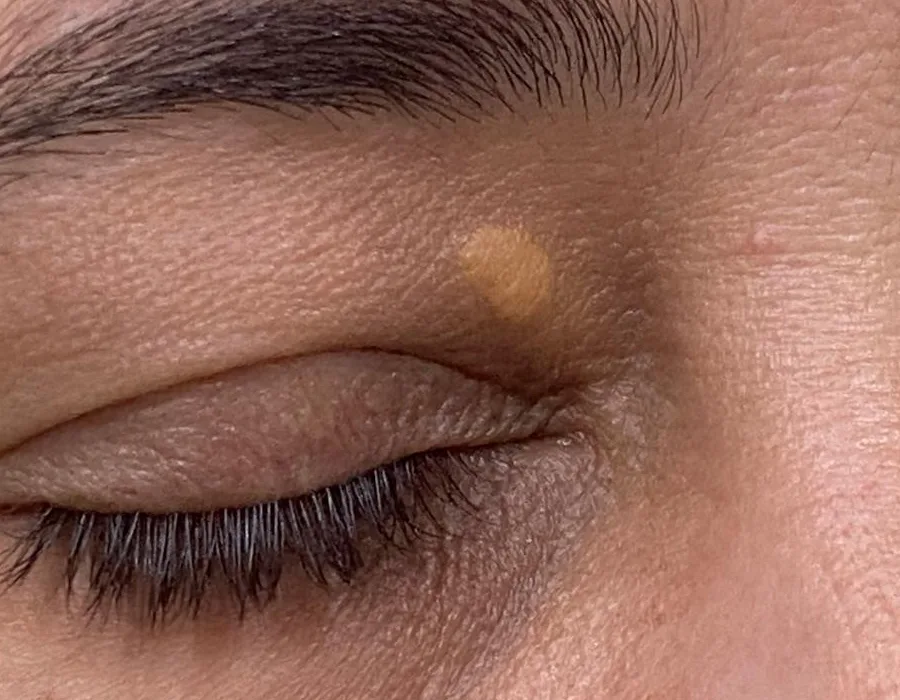

"Doutor, apareceu uma mancha amarela no canto do olho. Minha mãe tinha igual. É gordura?" É gordura, sim. E o passo seguinte é olhar o colesterol.

## O que é o xantelasma

O xantelasma é uma placa amarelada, plana ou levemente elevada, macia ao toque, que aparece nas pálpebras. O local mais comum é o canto interno da pálpebra de cima, perto do nariz. Muitas vezes surge dos dois lados.

*Xantelasma na pálpebra de cima, perto do canto interno do olho. Foto de paciente, publicada com autorização.*

É formado por células de defesa da pele cheias de gordura, e é o tipo mais comum de xantoma, o nome dado aos depósitos de gordura na pele. Não dói nem atrapalha a visão, mas tende a crescer devagar e raramente some sozinho.

## O que o xantelasma tem a ver com o colesterol

Cerca de metade das pessoas com xantelasma tem colesterol ou triglicérides alterados no exame de sangue. A outra metade tem exames normais, e mesmo assim a placa aparece.

Mesmo quando o exame vem normal, a placa não é só um problema da pele. Os estudos que comparam pessoas com e sem xantelasma mostram diferenças além do colesterol total:

- **No sangue:** uma meta-análise de 15 estudos, com 854 pessoas com xantelasma, encontrou colesterol total e LDL ("colesterol ruim") mais altos e mais apolipoproteína B, uma proteína ligada à aterosclerose (acúmulo de gordura na parede das artérias).
- **Nas artérias:** a mesma análise encontrou a parede da artéria do pescoço (carótida) mais espessa, um sinal de aterosclerose.
- **No coração:** um estudo dinamarquês acompanhou 12.745 pessoas por até 33 anos. Quem tinha xantelasma no início teve risco 48% maior de infarto, mesmo levando em conta o colesterol, os triglicérides e outros fatores de risco conhecidos.

São estudos observacionais. Eles mostram associação, e não que a placa cause infarto.

### Quais exames pedir

Na consulta, peço o perfil de lipídios (colesterol total, LDL, HDL e triglicérides) e, conforme o caso, glicemia e hormônios da tireoide. O diabetes e as alterações da tireoide também podem estar por trás da placa. Quando os exames vêm alterados ou há outros fatores de risco, como pressão alta, cigarro ou infarto na família, encaminho para um cardiologista ou um endocrinologista.

## Como é o tratamento

O xantelasma é benigno, então tratar a placa é uma escolha, em geral por incômodo estético. A técnica depende do tamanho, da profundidade e do local da lesão, e da pele da pálpebra em volta.

Uma revisão de 2023 analisou 49 estudos, com 1.329 pacientes. As opções descritas são:

- **Retirada cirúrgica:** indicada para placas maiores e mais profundas. Em placas extensas, pode ser combinada com a cirurgia da pálpebra (blefaroplastia).
- **Laser ablativo:** remove a placa em camadas finas. Um dos mais estudados é o laser de érbio (Er:YAG): mais de 80% dos pacientes tiveram melhora acima de 75%.
- **Ácido tricloroacético:** um ácido aplicado na placa, em concentração alta, por um médico. Em uma série canadense de 77 pacientes tratados com a concentração de 80%, 97% tiveram melhora, mas cerca de 1 em cada 4 relatou que a placa voltou.
- **Eletrocirurgia (corrente elétrica), plasma e criocirurgia (congelamento):** outras formas de remover as camadas superficiais da placa, usadas em lesões menores.

A pele da pálpebra é fina, e com todos os métodos, o efeito colateral mais comum foi a mudança de cor da pele no local (mais clara ou mais escura). Nas placas perto do canto do olho, retirar pele demais pode puxar a pálpebra para baixo. Por isso, em placas grandes, o tratamento pode ser feito em etapas.

No consultório, uso o plasma e o ácido tricloroacético. A escolha entre os dois depende da placa.

### O xantelasma pode voltar

Pode, com qualquer técnica. Por isso, o acompanhamento inclui controlar o colesterol, quando ele está alterado, e repetir o tratamento local se a placa reaparecer.

## Nem toda mancha amarela na pálpebra é xantelasma

- **Siringomas:** bolinhas pequenas e da cor da pele, ou levemente amareladas, embaixo dos olhos. São tumores benignos das glândulas de suor.
- **Hiperplasia sebácea:** bolinhas amareladas com um pequeno ponto no centro, mais comuns na testa e no nariz.
- **Milium:** bolinhas brancas e duras, como grãos de areia sob a pele.
- **Xantogranuloma necrobiótico:** raro. Placas mais endurecidas, avermelhadas ou alaranjadas, às vezes com ferida, e associadas a doenças do sangue. Pede biópsia.

## Quando procurar um dermatologista

Procure avaliação quando a placa aparecer, mesmo que não incomode, para confirmar o diagnóstico e pedir os exames de sangue. Procure também se a placa cresceu, se ficou endurecida ou se voltou depois de um tratamento.

Veja como são tratados o xantelasma e outras lesões benignas na [cirurgia dermatológica](/cirurgia-dermatologica/).
